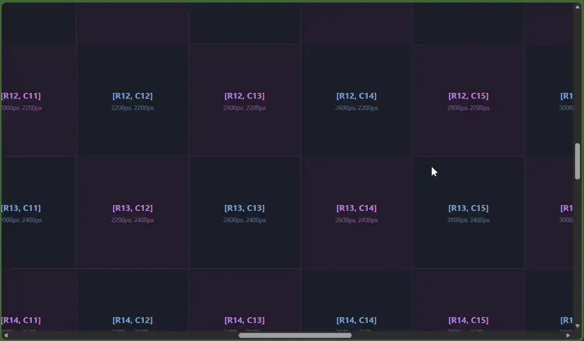
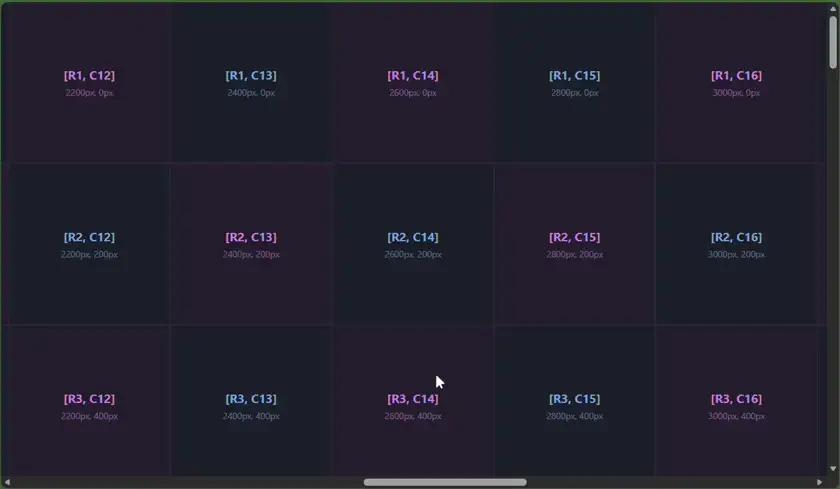

# Drag to Scroll

Hold **`Ctrl` + Right-Click** (or just **Right-Click**) and drag your mouse to scroll naturally and effortlessly across desktop apps—including web browsers (Chrome, Edge, Firefox), documents (Word, PDFs), code editors (VS Code), and File Explorer.

## Vertical & Horizontal Scrolling

## Hands-Free Continuous Cruising

---

## ⚡ Quick Start (How to Use)

* **Choose Your Trigger:** Go to settings to select your preferred activation method: `Ctrl + Right-Click` (deliberate, supports cruising) or `Right-Click Only` (seamless, disables cruising).
* **To Scroll:** Hold down your chosen trigger, and move your mouse up, down, left, or right.
* **To Stop:** Release the Right Mouse Button.
* **Normal Right-Click:** Just click the Right Mouse Button in place without dragging—it passes straight through to open your context menus as usual, regardless of which trigger mode you use.
* **Need an App's Own Ctrl + Right-Click?** Just tap `Ctrl + Right-Click` in place without moving your mouse—it passes straight through to trigger the app's native shortcut or context menu as usual.
* **Hands-Free Cruising (Optional):** Turn on *Continuous Cruising* in settings. Drag to start moving, let go of your chosen anchor key (Ctrl or Right-Click), and the page will glide continuously on its own. Any standard mouse click, tap, or non-modifier key press stops the glide instantly.

---

## 🛡️ Recommended Setup (Best Balance of Control & Safety)

While **Continuous Cruising** and **Out-of-Bounds Dragging** are disabled by default to keep initial scrolling simple and predictable, enabling them together unlocks the full power of the mod. If you turn them on, here is the recommended configuration:

* **Trigger Key Combination:** `Ctrl + Right-Click (Supports Cruising)` — Preserves native right-click dragging in File Explorer, browsers, and creative tools while unlocking hands-free cruising.
* **Allow Out-of-Bounds Dragging:** `Enabled` — Lets you drag and cruise comfortably without stopping when your cursor crosses window borders or reaches the edge of your monitor.
* **Continuous Cruising (Hands-Free):** `Enabled` — Glide through long articles, logs, and source code effortlessly.
* **Cruising Anchor Key:** `Hold Right-Click (Release Ctrl)` — **Recommended.**
* **Dynamic Velocity Mode:** `Standard (Smooth & Controlled)` — Gives you 1:1 precision on slow movements with a gentle boost on quick flicks.
* **Ultra-Smooth Scrolling:** `Enabled` — Delivers fluid, trackpad-style scrolling increments.

> 💡 **Why choose "Hold Right-Click" as your Cruising Anchor?**
> When you keep the Right Mouse Button held down to cruise (releasing `Ctrl`), the scrolling window retains mouse capture (`SetCapture`). Compared to the `Hold Ctrl` anchor during out-of-bounds dragging, this gives you two practical benefits:
> 1. **Safer Stop Clicks:** Because the scrolling window keeps mouse capture while Right-Click is held, the button release and other clicks go to the scrolling window, so they don't reach the windows behind it—even when your cursor is over Administrator-elevated apps (like Task Manager), modern UWP/system surfaces (Start Menu, Settings, Calculator), or excluded processes (`conhost.exe`).
> 2. **Consistent Custom Cursor:** Because a physical mouse button remains held, Windows keeps the custom high-contrast cruising cursor visible across the screen instead of reverting to the standard arrow outside the window.

---

## ✨ Why You'll Love It (Key Highlights)

* 🎛️ **Customizable Triggers:** Choose between the deliberate `Ctrl + Right-Click` or the seamless `Right-Click Only` mode to perfectly match your workflow.
* 🎯 **Smart Straight-Line Panning:** No more accidental diagonal wobbling when reading documents or scanning spreadsheets. Move up/down or left/right, and the mod keeps your movement locked straight on track.
* 👁️ **High-Contrast, All-Surface Cursors:** Custom drag cursors with protective contours are built directly into the mod. Whether you use pure Dark Mode, bright white documents, or customized themes, the cursor stays crisp, sharp, and easy to follow.
* 🔍 **Zero Accidental Zooming:** Holding `Ctrl` while scrolling in web browsers usually messes up your page zoom. If you use the `Ctrl + Right-Click` trigger, this mod automatically shields your browser during both the drag and the gentle stop, so you never accidentally blow up text or shrink your screen.
* 🚀 **Dynamic Velocity Modes:** Choose your preferred flick responsiveness (`Off`, `Gentle`, `Standard`, `Fast`, or `Ultra Fast`) to scale from pure 1:1 precision to high-speed traversal across long documents.
* 🪟 **Seamless Out-of-Bounds Dragging *(Optional*):** Enable this in settings to keep scrolling smoothly even if your mouse cursor wanders completely off the edge of the window or screen.
* 📱 **Touchscreen or Traditional Feel:** Choose between natural pull-to-scroll (moving down drags content down, just like a phone or tablet) or classic wheel style in settings.

---

## ⚠️ Compatibility & Good to Know

* **Right-Click Only Mode Trade-offs:** If you select the "Right-Click Only" trigger, cruising is disabled and right-mouse dragging is overridden globally. Native right-drag features in other apps (like Explorer's right-drag file copying or browser mouse gestures) will trigger scrolling instead. Additionally, quickly tapping right-click may occasionally register as a double-right-click in certain list views.
* **Cruising Cursor Visibility:** When using the "Hold Ctrl" cruising anchor, your custom drag cursor will revert to the standard Windows arrow anytime it leaves the application window (such as hovering over the desktop, taskbar, or other apps). This happens because Windows strictly requires a physical mouse button to be held down to maintain a global cursor override. Use the "Hold Right-Click" anchor if you want the custom drag cursor to remain visible across the entire screen.
* **Cross-Process Cruising Clicks (Ctrl-Anchor Mode):** When cruising with the `Ctrl` anchor and Out-of-Bounds dragging enabled, clicking on standard desktop apps (like browsers, Notepad, or File Explorer) stops the glide cleanly without clicking the app behind your cursor. However, clicking on modern UWP/system surfaces (Start Menu, Settings, Calculator), Administrator-elevated windows (Task Manager, `mmc.exe` / `services.msc`) from a non-elevated app, or excluded apps (`conhost.exe`) will stop cruising while allowing that click through.
* **Microsoft Store & Modern UWP Apps (Not Supported):** Modern packaged applications installed from the Microsoft Store (such as Calculator, Weather, Microsoft To Do) as well as Windows system surfaces handle input through isolated modern pointer pipelines that bypass classic Win32 mouse messages.
* **Online Games & Anti-Cheat Protection:** Software with native `Ctrl + Right-Click` dragging shortcuts (such as Blender or CAD applications) or games protected by kernel anti-cheats (e.g., Vanguard, BattlEye, Easy Anti-Cheat) may conflict with global input hooks. You can safely exclude those specific programs under the mod's **Advanced** tab in Windhawk.
* **Portable Windhawk & Elevation:** The mod works in elevated applications when using the standard Windhawk service. If you are using portable Windhawk without running it as Administrator, elevated application windows cannot be targeted.
* **Console Windows (`conhost.exe`):** This mod intentionally excludes classic command prompt windows (`conhost.exe`) by default due to input compatibility.

---

### 🧩 More from this author
* **[Explorer Custom Shortcuts](https://windhawk.net/mods/explorer-custom-shortcuts)** – Customizable keyboard shortcuts for File Explorer: open terminal, copy paths, create files/folders, toggle hidden items, and launch apps with hotkeys.
* **[WinRAR Tweaks](https://windhawk.net/mods/winrar-tweaks)** – All-in-one quality-of-life enhancements for WinRAR that modernize navigation and file size readability without altering archive behavior.

### Author & Attribution
* **Created and maintained by ArvindSaini978 ([GitHub](https://github.com/ArvindSaini978)).**
