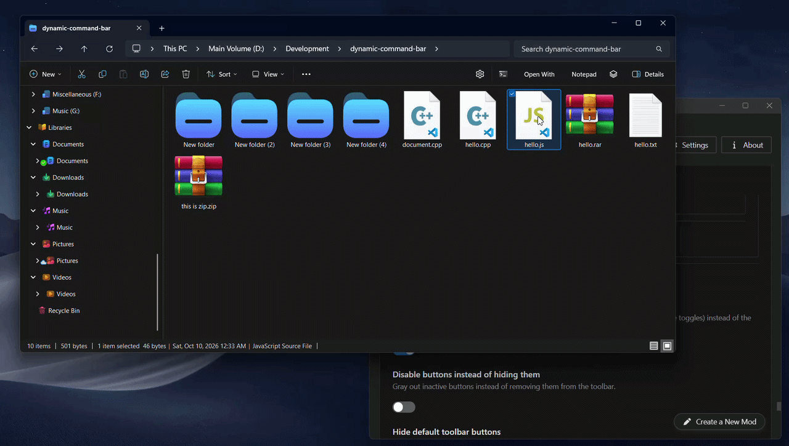

# Dynamic Explorer Command Bar

Customize, automate, and extend the **Windows 11 File Explorer command bar** with your own buttons, dropdown menus, smart argument tokens, and dynamic extension-based visibility rules.

Designed for Windows 11 with the WinAppSDK (WinUI 3) File Explorer.

---

## Key Features

* **Custom Buttons & Dropdown Menus** — Add single-click toolbar buttons or nested dropdown menus (supporting up to 8 levels of hierarchy via parent referencing) running commands, scripts, or internal shell actions.
* **Flexible Ordering & Sorting** — Order buttons and menu items using priority numbers (`order`). Supports integers, arbitrary decimals (`1.2`, `1.25`) to easily insert items in-between without renumbering, and negative numbers (`-1`) to place items at the very beginning.
* **Context-Aware Dynamic Visibility** — Automatically show or hide individual buttons depending on the file extensions or item types highlighted in Explorer, including single (`single`) or multi-item (`multiple`) selection filters.
* **Dynamic UI Labels & Clamping** — Embed live tokens (`%base%`, `%name%`, `%c%`, `%ext%`, `%d_name%`) directly in button and dropdown labels that update in real time. Labels truncate cleanly with an ellipsis (`...`) past 24 characters on toolbar buttons and 48 characters in menus, with the complete label preserved in the hover tooltip.
* **Flexible Inactive State** — Choose between completely hiding (`Collapsed`) or graying out (`Disabled`) buttons when selection conditions are not met.
* **Advanced Command Tokens** — Pass active folder paths, file names, counts, extensions, parent directories, or selected file lists straight into your apps.
* **Batch Spawning (`%sel_each%`)** — Automatically launch an application instance for each highlighted item with built-in safety throttling.
* **Secondary Command Bar Placement** — Dock custom actions on the right side of the command bar (next to the Details/Preview pane toggles) for a clean dual-toolbar layout.
* **Theme-Aware & Executable Icons** — Support fluent Segoe glyphs (browse codes on [Segoe Fluent Icons](https://learn.microsoft.com/en-us/windows/apps/design/iconography/segoe-fluent-icons-font)), short application names runnable via Run or Terminal (`cmd.exe`, `notepad.exe`, `winrar.exe`), local file paths (`.exe` / `.dll` / `.ico`), Store apps (`shell:AppsFolder\...`), and dual Light/Dark icons via `LightPath | DarkPath` syntax.
* **Hide Built-in Explorer Buttons** — Declutter your toolbar by selectively hiding native Windows 11 commands (Cut, Copy, Paste, Share, Sort, View, 'See more'), contextual tools (Rotate, Extract all), the Details pane toggle, and Recycle Bin actions (Restore selected, Restore all, Empty Recycle Bin).
* **Rename Native Buttons** — Save horizontal space by customizing the text labels of default system actions (e.g., shorten "Empty Recycle Bin" to "Empty bin", "Details pane" to "Info", or "Rotate right" to "Right").
* **Open on Hover** — Open dropdown menus smoothly on cursor hover.

---

## Built-in Shell Actions

Instead of an executable path, you can set **Command** to one of these built-in actions.

> **Tip:** Both `internal:` and `int:` prefixes are supported. 
> All command names are completely **case-insensitive** (e.g., `internal:openWith`, `internal:openwith`, `internal:OpeNWitH`, and `INT:OPENWITH` all work identically).

* `internal:OpenWith` — Opens Windows native Open With dialog for the active item.
* `internal:FolderOptions` — Opens Classic Folder Options dialog.
* `internal:TogglePreview` — Toggles the File Explorer Preview pane.
* `internal:ToggleDetails` — Toggles the File Explorer Details pane.

---

## Command Parameters & Dynamic Tokens

The mod supports rich parameter expansions that dynamically resolve the state of the active File Explorer tab:

> **Tip:** Tokens work with or without a closing `%` (e.g., `%base%` or `%base`). When passing standard Windows shell environment variables (such as `%cd%` or `%date%`) in commands, use `%%` to escape literal percent signs (e.g., `%%cd%%`), or use the full bracketed token forms (e.g., `%count%` instead of `%c`) to avoid collisions.

| Token | Description | Example Output |
| :--- | :--- | :--- |
| `%base%` / `%basename%` | Selected item base names without extension | `Archive` |
| `%file_name%` | First item base name (for extract/output folders) | `Archive` |
| `%path%` / `%dir%` / `%d%` | Full physical path of the currently active folder | `C:\Projects\App` |
| `%sel%` / `%f%` | All selected items as space-separated quoted paths | `"C:\a.txt" "C:\b.png"` |
| `%1%` / `%1` | Full path of the first selected item | `"C:\Projects\App\Notes.txt"` |
| `%sel_each%` | Executes a distinct process instance per selected item (capped at 20) | `"C:\Item.txt"` |
| `%files%` | Space-separated quoted paths of selected regular files only | `"C:\doc.txt"` |
| `%folders%` | Space-separated quoted paths of selected directories only | `"C:\FolderA"` |
| `%name%` / `%n%` | Selected file names only (without directory path) | `"Notes.txt"` |
| `%ext%` | File extension of the first selected item | `.png` |
| `%count%` / `%c%` | Total number of selected items | `3` |
| `%d_smart%` | Selected directory if one is chosen, otherwise falls back to active folder | `C:\Projects\App\Sub` |
| `%d_name%` | Display name of the active folder or virtual location | `App` or `This PC` |
| `%parent%` / `%p%` | Parent folder path of the active tab | `C:\Projects` |
| `%%` | Literal percent sign escape | `%` |

Wrap placeholders in double quotes when necessary (e.g., `-d "%path%"` or `code.exe "%sel%"`).

> * **Virtual Shell Locations:** Locations such as *This PC*, *Recycle Bin*, and *Control Panel* do not possess a physical filesystem path. For safety, folder path argument tokens (`%path%`, `%dir%`, `%d%`, `%d_smart%`, `%p%`) resolve to an empty string in these views to prevent destructive scripts from unintentionally targeting user directories. The working directory (`%USERPROFILE%`) is still used in the background so applications launch cleanly. Use `%d_name%` to retrieve the native shell title (e.g. `This PC` or `Recycle Bin`).
> * **UI Labels:** To prevent toolbar buttons from overflowing, multi-item tokens like `%base%`, `%name%`, and `%1%` automatically evaluate to the **first highlighted item's name** rather than full multi-line absolute paths.

---

## Dynamic File Extension Filtering

The **File extension filter** (`matchExtensions`) field lets you display toolbar actions contextually:

> **How Evaluation Works:** 
> * Multiple comma-separated tokens evaluate using **`OR`** logic (matches if *any* rule succeeds).
> * Use **`+`** within a rule for **`AND`** logic (e.g. `files + single`).
> * Negative tokens prefixed with **`-`** or **`~`** (e.g. `-zip`, `-exe`, `-folder`) act as an **absolute veto** — if any highlighted item matches an exclusion rule, the button is immediately hidden.
> * **`hide` Override:** Adding `hide` (or `hidden`) anywhere in the filter permanently disables and hides the button under all conditions. This is ideal if you want to temporarily shelve a button or menu without having to delete its configuration from settings.

### Available Filter Keywords

* **`hide` / `hidden`** — Absolute override. Keeps the button permanently hidden until removed.
* **Leave blank or `*`** — Always show the button regardless of selection.
* **`none` / `empty` / `nothing` / `unselected`** — Show **only** when nothing is selected (0 items highlighted). Hides as soon as any item is clicked.
* **`selected` / `any`** — Show whenever at least one item of any kind is highlighted.
* **`files` / `file`** — Show if regular files are selected (regardless of count).
* **`folders` / `folder` / `dir`** — Show if folders/directories are selected (regardless of count).
* **`mixed` / `mixed_selection`** — Show exclusively when both regular files and folders are highlighted at the same time.
* **`single`** — Show only when exactly 1 item (file or folder) is selected.
* **`multiple` / `multi`** — Show only when 2 or more items are selected.
* **`single_file`** *(or `single_files`)* — Show exclusively when exactly 1 regular file is selected.
* **`multi_file`** *(or `multi_files`)* — Show exclusively when 2 or more regular files are selected.
* **`single_folder`** *(or `single_folders`)* — Show exclusively when exactly 1 folder is selected.
* **`multi_folder`** *(or `multi_folders`)* — Show exclusively when 2 or more folders are selected.
* **`only <ext>`** *(e.g. `only txt`, `only:cpp`, `only txt, only cpp`, `only(txt, cpp)`)* — Strict whitelist. Shows exclusively when **every single highlighted item** matches one of the specified extensions (vetoes mixed selections and folders).
* **`txt, js, cpp`** — Standard extension filter (shows if *any* selected file matches).

### Combining Rules (`OR`, `AND`, and Exclusions)

* **`folders, multi_file`** — Shows when any folder is selected **OR** 2+ files are selected (ideal for batch actions or directory tools).
* **`files, mixed`** — Shows when regular files are selected **OR** when a mixed bundle of files and folders is selected (hiding only when purely folders or nothing is chosen).
* **`none, folders`** — Shows in empty directory backgrounds **OR** when folders are selected.
* **`single_file, single_folder`** — Shows for any single item, but automatically hides on multi-selection.
* **`files + single`** — Same as `single_file` (uses `+` for strict intersection).
* **`folders, multi_file, -zip`** — Matches folders or multiple files, but immediately hides if any item in the selection is a `.zip` file.
* **`files, hide`** — Kept permanently hidden because `hide` takes absolute precedence over all other tokens.
* **`only txt, only md`** — Shows when only `.txt` and/or `.md` files are highlighted (hides immediately if a `.png` or folder is included).

---

## Button Ordering & Positioning (`order`)

Instead of cutting and pasting configuration code to reorder items:
* Set **Display Order / Priority** (`order`) to any number (e.g. `1`, `2`, `3`). Lower numbers appear first.
* Use decimals (e.g. `1.5`) to insert an item between `1` and `2` without having to renumber subsequent buttons.
* Use negative numbers (e.g. `-1`) to position an item before unnumbered buttons.
* Inside dropdown menus, `order` sorts items strictly within that specific menu container.

---

## Creating Dropdown Menus & Hierarchies

To place buttons inside a dropdown menu:
1. Create a menu container item with **Item Type** set to `menu`, and assign it a unique **Item ID** (e.g. `tools_menu`).
2. For any button or submenu you want nested inside it, set its **Parent Menu ID** to that menu's ID (`tools_menu`).
3. Leave **Parent Menu ID** blank for items that should appear directly on the top toolbar.

---

## Decluttering & Customizing Native Explorer Buttons

You can manage native Windows 11 toolbar buttons directly from the Windhawk Settings tab:

### 1. Hiding Built-in Buttons (`hideDefaultButtons`)
Toggle any built-in action to hide it completely from File Explorer:
* **Core Actions:** `New`, `Cut`, `Copy`, `Paste`, `Rename`, `Share`, `Delete`, `Sort`, `View`, and `See more` (`...` menu).
* **Separators:** Selectively remove the vertical separator line after `New`, after `Delete`, or after `View`.
* **Contextual Tools:** `Set as background`, `Rotate left`, `Rotate right`, and `Extract all`.
* **Panes:** `Details pane toggle`.
* **Recycle Bin:** `Restore selected items`, `Restore all items`, and `Empty Recycle Bin`.

### 2. Renaming Native Labels (`systemButtonLabels`)
Default Windows command bar buttons with text labels can be overridden to save horizontal toolbar space:
* Set a custom short string (e.g., `"Left"` for Rotate Left, `"Empty bin"` for Empty Recycle Bin, or `"Info"` for Details pane).
* Leave the setting blank (`""`) to keep the default localized Windows text.

---

## Comparison with Existing Mods

* **vs. `explorer-command-bar` (DanRotaru)**: 
  The original mod provides static command buttons and hides built-in buttons. **Dynamic Explorer Command Bar** extends this with real-time selection-based extension filtering, live UI label tokens, custom native button labels, per-item execution (`%sel_each%`), secondary toolbar placement, dual Light/Dark icons, and an expanded token engine (`%files%`, `%folders%`, `%n%`, `%ext%`, `%c%`, `%d_name%`, `%p%`).
* **vs. `explorer-custom-shortcuts` (ArvindSaini978)**:
  While *Explorer Custom Shortcuts* provides background keyboard hotkeys, this mod brings dynamic parameter evaluation directly to the visual WinUI command bar.

---

## Author & Attribution

* **Created and maintained by ArvindSaini978 ([GitHub](https://github.com/ArvindSaini978)).**
* Extended from *Explorer Command Bar* by DanRotaru (MIT), with token expansion adapted from *Explorer Custom Shortcuts* (ArvindSaini978) and thread dispatch from *Explorer Folder Bookmarks Bar* (Maxim Fomin).
