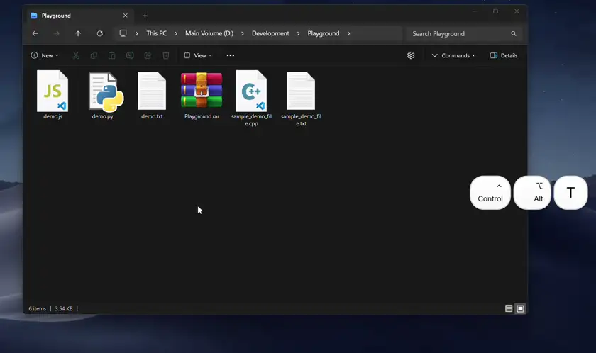
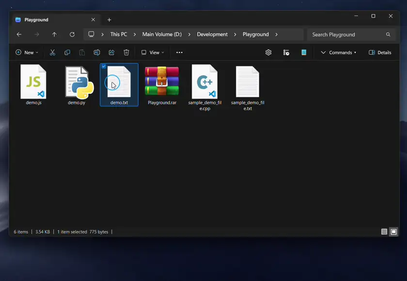
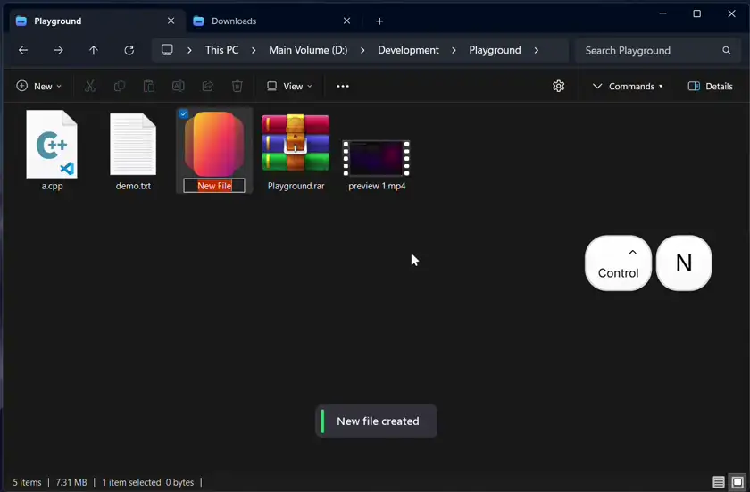

# Explorer Custom Shortcuts

Adds customizable keyboard shortcuts to Windows File Explorer: open terminal, copy clean paths, create files and folders, toggle hidden items, and launch custom apps with hotkeys.

Includes subtle, theme-matching on-screen confirmation notifications so you always know an action succeeded.

---

## Ready to Use: Default Shortcuts

These shortcuts work immediately once the mod is enabled:

| Shortcut | Action | Description |
| :--- | :--- | :--- |
| `Ctrl + Alt + T` | **Open Terminal Here** | Opens Windows Terminal (or PowerShell) in the current directory. |
| `Ctrl + Shift + Alt + T` | **Open Terminal (Admin)** | Opens Windows Terminal or PowerShell as Administrator. |
| `Alt + N` | **Open with Notepad** | Opens selected file(s) in Notepad. |
| `Alt + C` | **Copy Name** | Copies selected file/folder name(s) including extensions to clipboard. |
| `Alt + H` | **"Open With..." Dialog** | Opens the native Windows "How do you want to open this file?" dialog. |
| `Ctrl + Alt + Enter` | **Show Properties** | Opens individual Properties dialogs for selected items. |
| `Ctrl + Shift + B` | **Open Recycle Bin** | Navigates the current tab directly to the Recycle Bin. |
| `Ctrl + Shift + Del` | **Empty Recycle Bin** | Prompts confirmation to wipe the Recycle Bin. |

### Ready in Settings *(Disabled by Default)*

These popular shortcuts are pre-configured in settings and can be enabled with a single toggle:

| Shortcut | Action | Description |
| :--- | :--- | :--- |
| `Ctrl + H` | **Toggle Hidden Files** | Toggles visibility of hidden files & folders. |
| `Ctrl + Shift + E` | **Toggle File Extensions** | Toggles display of file extensions. |
| `Ctrl + Shift + C` | **Copy Path** | Copies full path(s) of selected items to clipboard. |

### Desktop Shortcuts *(Disabled by Default)*

Under the **Desktop Background Support** section in mod settings, turn on **Enable Shortcuts on Desktop** to allow all hotkeys (open terminal, create files/folders, copy paths, dialogs) to trigger while focused on the desktop wallpaper.

---

## Action Previews

**Terminal & "Open With" Dialog (`Ctrl + Alt + T` / `Alt + H`)**

**Open with Notepad & "Open With" Dialog (`Alt + N` / `Alt + H`)**

**Smart File Creation & Empty Recycle Bin (`newSmartFile` / `Ctrl + Shift + Del`)**

---

## Key Features

* **Custom Keyboard Shortcuts** — Assign shortcuts using letters, numbers, function keys (`F1–F12`), or navigation keys (`Delete`, `Backspace`, `Space`, `Enter`, etc.) combined with `Ctrl`, `Shift`, or `Alt`.
* **Smart Explorer Arguments** — Pass active folder paths, selected file names, extensions, or file lists directly into your custom apps or scripts.
* **Flexible Run Modes** — Run an application once with all selected items, or launch it individually for each selected file or folder.
* **Built-in Shell Actions** — Quick built-in commands to create text files, folders, or shortcuts, copy paths/names, toggle view settings, or open advanced dialogs.
* **Desktop Background Support** — Optionally enable all keyboard shortcuts directly on the Windows desktop wallpaper and icons *(configurable toggle in Settings, disabled by default)*.
* **Typing & Rename Protection** — Shortcuts automatically pause while you are renaming a file, typing in the address bar, searching, or interacting with dialogs so they never interfere with your typing.
* **On-Screen Action Popups** — Shows a clean, brief notification on your screen whenever background actions finish. Automatically matches your Windows accent color and Dark/Light theme, and can be disabled in settings.

> **Windows 10 Ribbon Note:** Default shortcuts using `Alt` (such as `Alt+H` or `Alt+C`) take precedence over Windows 10 Explorer ribbon access keys. You can remap or disable these bindings in the mod settings if you rely on ribbon mnemonics.

---

## Internal Explorer Commands

You can assign any hotkey directly to built-in commands by setting the path to one of the following identifiers.

> **Prefixes:** Supports both `internal:` and shorthand `int:` (e.g. `int:copyPath` or `internal:copyPath`).
>
> **Tip:** All command names are completely **case-insensitive** (e.g., `internal:copyPath`, `internal:copypath`, `internal:CopyPatH`, and `INT:CopyPatH` all work identically).

#### File & Folder Management
| Command | Default Key | Description |
| :--- | :--- | :--- |
| `internal:newTextFile` | — | Creates `New Text Document.txt` and enters inline rename. |
| `internal:newSmartFile` | — | Creates an extensionless `New File` and enters inline rename for any code/text extension (`.js`, `.py`, `.json`, `.cpp`, `.md`, etc.). |
| `internal:touchFile` | — | Updates the `Last Modified` timestamp of selected item(s) to the current time. |
| `internal:newFolder` | — | Creates `New Folder` and enters inline rename. |
| `internal:createShortcut` | — | Generates `.lnk` shortcuts for all selected items. |
| `internal:packIntoFolder` | — | Moves selected items into a `New Group` folder. |
| `internal:bulkDuplicate` | — | Duplicates selected items in-place (` - Copy`). |

> **Tip on `internal:newSmartFile`:** Creates a clean, empty file without a default extension so you can type any extension directly without Windows warning prompts. Since it creates a 0-byte file, it is designed for text, code, and configuration files (e.g., `.cpp`, `.py`, `.json`, `.yaml`, `.gitignore`). It does not create binary document formats (such as `.docx` or `.xlsx`) which require application-specific file templates.

#### Clipboard & Paths
| Command | Default Key | Description |
| :--- | :--- | :--- |
| `internal:copyPath` | `Ctrl + Shift + C` *(Disabled)* | Copies full path(s) to clipboard. |
| `internal:copyName` | `Alt + C` | Copies filename(s) including extensions. |
| `internal:copyUnixPath` | — | Copies full path(s) with forward slashes (/) for Git Bash, Python, or scripts. |
| `internal:copyFolderPath` | — | Copies the active directory path directly, ignoring file selections. |

#### Navigation & Dialogs
| Command | Default Key | Description |
| :--- | :--- | :--- |
| `internal:showProperties` | `Ctrl + Alt + Enter` | Opens individual Properties dialogs for selected items (Max 15). |
| `internal:openWith` | `Alt + H` | Opens the native "How do you want to open this file?" dialog. |
| `internal:openRecycleBin` | `Ctrl + Shift + B` | Navigates the active tab to the Recycle Bin. |
| `internal:emptyRecycleBin` | `Ctrl + Shift + Del` | Prompts confirmation to wipe the Recycle Bin. |
| `internal:openParentFolder` | — | Navigates the active tab to its parent folder. |
| `internal:folderOptions` | — | Opens the classic Folder Options property window. |

> **Desktop Usage Note:** 
> * **`internal:openRecycleBin`** navigates in-place when inside an Explorer tab, and opens a new Explorer window directly to the Recycle Bin when triggered from desktop.
> * **`internal:openParentFolder`** automatically detects when triggered from the desktop and notifies you that you are already at the root directory.

#### View Toggles
| Command | Default Key | Description |
| :--- | :--- | :--- |
| `internal:toggleHiddenFiles` | `Ctrl + H` *(Disabled)* | Toggles visibility of hidden files & folders. |
| `internal:toggleFileExtensions` | `Ctrl + Shift + E` *(Disabled)* | Toggles display of file extensions. |
| `internal:toggleCheckboxes` | — | Toggles the display of item selection checkboxes. |

#### Terminals & Tools
| Command | Default Key | Description |
| :--- | :--- | :--- |
| `internal:openWithNotepad` | `Alt + N` | Opens selected file(s) in Notepad. |
| `internal:openTerminal` | `Ctrl + Alt + T` | Opens Windows Terminal (or PowerShell) in the folder. |
| `internal:openTerminalAdmin` | `Ctrl + Shift + Alt + T` | Opens Terminal/PowerShell as Administrator. |
| `internal:openCmd` | — | Opens the classic Command Prompt in the folder. |
| `internal:openCmdAdmin` | — | Opens the classic Command Prompt as Administrator. |
| `internal:openDirInCode` | — | Opens the active directory in VS Code as a workspace project, ignoring selections. |
| `internal:openWithCode` | — | Opens selected items in VS Code (Max 10 folder windows, Max 50 files in one window). |

> **Persistent Settings Notice:** Toggles for hidden files, extensions, and checkboxes flip the native Windows Explorer shell settings directly (`SHGetSetSettings`). These changes affect all File Explorer surfaces globally and persist even if this mod is disabled.

---

### Available Tokens for Arguments & Examples

* **`%%`** — Literal percent sign (`%`). Useful for passing environment variables or script arguments directly to shells like `cmd.exe /c` (e.g. `%%PATH%%`), or URL-encoded percent signs without triggering token expansion.
* **`%f`** — All selected items as space-separated quoted paths (`"C:\a.txt" "C:\b.png"`).
* **`%files`** — Selected regular files only (skips selected folders).
* **`%folders`** — Selected folders only (skips selected regular files).
* **`%1`** — Quoted path of the first selected file or directory (`"C:\a.txt"`).
* **`%n`** / **`%name`** — File or folder names only without absolute directory paths (`"a.txt"`).
* **`%base`** / **`%basename`** — File names without extension (`"document"` from `"document.pdf"`, or `"LICENSE"` for extensionless files). Selected folders retain their full name without stripping dots (e.g. `"v1.2"`).
* **`%c`** / **`%count`** — Total number of selected items as an integer (`3`). In loop modes, this resolves to `1`.
* **`%ext`** — File extension of the first selected item (`.png`).
* **`%s`** — Space-separated paths with **smart-quoting** (automatically adds double-quotes only to paths containing spaces).
* **`%d`** / **`%dir`** — Active directory open in the current tab (`C:\Users\Name\Documents`). Virtual folders like *This PC* or *Recycle Bin* resolve to an empty string.
* **`%d_smart`** — Selected folder if one is highlighted; otherwise falls back to the current active directory.
* **`%d_name`** — Folder name of the active tab only, without the full directory path (`Documents`).
* **`%p`** / **`%parent`** — Parent directory path of the active tab.

> **Shell Interpreter Security Notice:** Path tokens are quoted according to standard Windows CRT command-line (`argv`) rules. If arguments are passed to script interpreters (e.g. `cmd.exe /c` or `powershell.exe -Command`), parameters may be re-parsed by that interpreter. Use native binary arguments or pass paths directly to target programs.

---

### Launch Modes & Use Cases

* **`batch`** (Default): Executes the application exactly once and passes the resolved command-line arguments.
  * *Use Case:* Code editors (opening a directory), Media players (queuing files), or bulk tools like PowerRename.
* **`loop_files`**: Executes the application once per selected file.
  * *Use Case:* Single-file image editors, batch converters, or per-file processing scripts.
* **`loop_folders`**: Executes the application once per selected folder.
  * *Use Case:* Batch archiving folders individually or folder-specific terminal operations.
  * *Note:* Directory tokens (`%d`, `%dir`, `%d_smart`, `%d_name`, and `%p`/`%parent`) resolve relative to each individual iterated folder rather than the active Explorer tab.

---

### Preset Ideas & External App Examples

You can bind custom hotkeys to external programs and scripts in settings using these recipes:

* **Windows Terminal with Dynamic Tab Title**
  * Path: `wt.exe` | Args: `--title "%d_name" -d "%d"` | Mode: `batch`
* **Search Active Folder in Everything**
  * Path: `Everything.exe` | Args: `-path "%d"` | Mode: `batch`
* **PowerToys PowerRename (Bulk Rename Selected Items)**
  * Path: `%ProgramFiles%\PowerToys\WinUI3Apps\PowerToys.PowerRename.exe` | Args: `%f` | Mode: `batch`
  * *(Or if installed in user profile: `%LocalAppData%\PowerToys\PowerRename.exe`)*
* **Git Bash in Current Directory**
  * Path: `git-bash.exe` | Args: `--cd="%d"` | Mode: `batch`
* **Open in VS Code (Current Directory or Selected Folder)**
  * Path: `code` | Args: `"%d_smart"` | Mode: `batch`
* **Queue Selected Media in VLC**
  * Path: `vlc.exe` | Args: `%f` | Mode: `batch`
* **Run Python Script with Selected Files**
  * Path: `python.exe` | Args: `"C:\Scripts\process.py" %f` | Mode: `batch`

---

### Comparison with Other Mods

* **`explorer-command-bar`** — Focuses on adding graphical toolbar buttons to the Windows 11 command bar. This mod is completely UI-less, designed specifically for low-latency keyboard workflows, batch looping (`loop_files`, `loop_folders`), and context-aware suppression during inline renames.
* **`keyboard-shortcut-actions`** — Dispatches global desktop hotkeys without Explorer awareness. This mod inspects active tabs, selected items, and folder paths directly to dynamically expand arguments.
* **Single-purpose mods** (`toggle-hidden-files`, `explorer-ctrln-newfile`, etc.) — Individual mods requiring separate installations. This mod combines those actions into a single configurable table using built-in commands (`int:` / `internal:`).

---

### 🧩 More from this author
* **[Drag to Scroll](https://windhawk.net/mods/drag-to-scroll)** – Smoothly pan and scroll across windows by holding Ctrl and dragging with the right mouse button.

### Author & Attribution

* **Created and maintained by ArvindSaini978 ([GitHub](https://github.com/ArvindSaini978)).**
* Process execution concepts (`ResolveCommandPath`, `ExecuteApp`) and shell window inspection adapt techniques from `explorer-command-bar` (DanRotaru, MIT).
* Settings toggling follows patterns established in `toggle-hidden-files` (Asteski).
