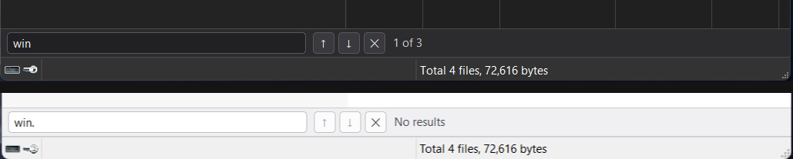
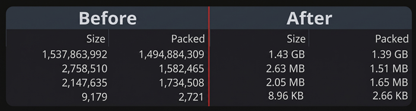
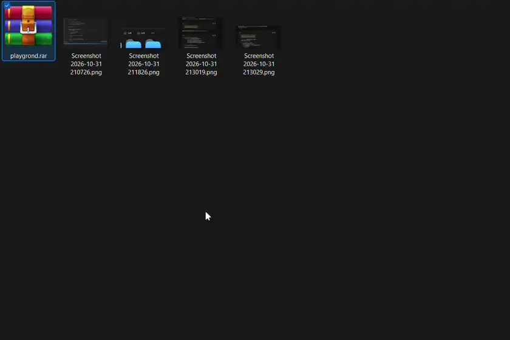
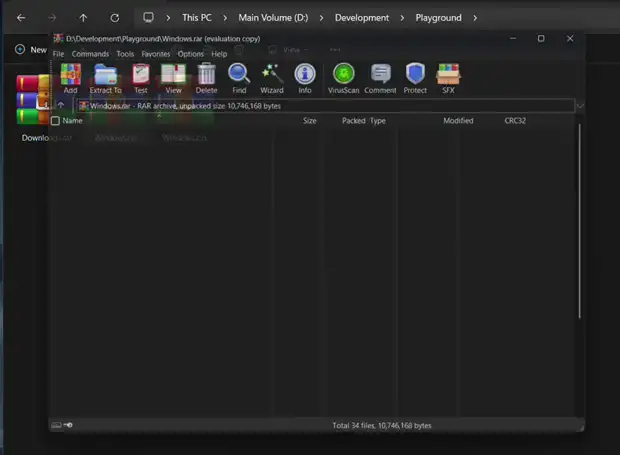
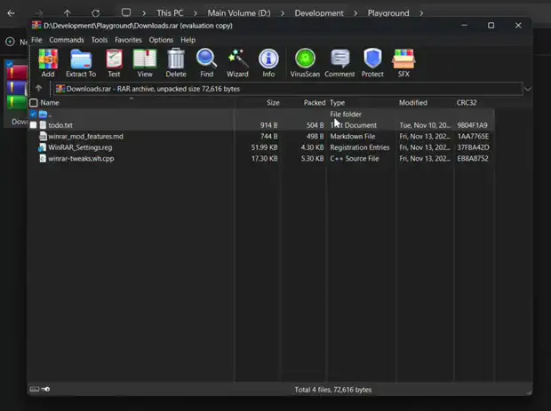

# WinRAR Tweaks

Simple quality-of-life improvements that make **WinRAR** cleaner, easier to read, and faster to use—without changing how your archives work.

---

## ✨ Features

* 🔍 **VS Code-Style Quick Filter Bar (`Ctrl+F`):** Press `Ctrl+F` (or just start typing with *Type to Search* enabled) to open a native bottom filter bar with `↑` / `↓` / `✕` buttons, a live match counter (`1 of 12`), `Enter` / `Shift+Enter` navigation, and optional `Alt+Enter` to select all matches at once. Automatically adapts to both Light and Dark themes.
* 📊 **Readable File Sizes (All Languages):** Converts long, hard-to-read byte numbers (like `121,815,400`) in the **Size** and **Packed** columns into clean units (`B`, `KB`, `MB`, `GB`, `TB`). Works automatically in all WinRAR display languages.
* 🏷️ **Optional `KiB` / `MiB` Labels:** Prefer technical binary units? Flip a single switch in Settings to display `KiB`, `MiB`, `GiB`, and `TiB` instead of `KB`, `MB`, `GB`, and `TB`.
* ⌨️ **Smart Close on `Esc`:** Press `Escape` to quickly close WinRAR just like modern apps. Smart enough to close the quick search bar, open popups, menus, dropdowns, or file-rename boxes first before closing the main window.
* 🚫 **Auto-Dismiss Trial Popup (Opt-In):** Optionally blocks the *"Please purchase WinRAR license"* and *"Trial Expired"* reminder popups on startup before they appear on screen (can be enabled in Settings).
* ⚙️ **Customizable Settings:** Enable or disable any feature independently at any time in the Settings tab.

---

## 🖼️ Previews

### Quick Filter Bar

### Human-Readable File Sizes

### Smart Close on Esc

### Auto-Dismiss Trial Popup

#### Before (Default)

#### After (WinRAR Tweaks)

---

## 🛠️ How It Works

* **Safe Quick Filtering:** Instead of deleting rows from WinRAR's list (which would break extraction indices), the quick filter bar highlights matching files in place, scrolls the active match into view, and lets you cycle through matches with `Enter` / `Shift+Enter` or `Up` / `Down`. Clicking the empty bar area returns focus to the file list while keeping your match highlighted.
* **Smart Size Formatting:** Formats raw byte numbers on the fly as you browse folders inside an archive, supporting every language automatically.
* **Safe `Esc` Handling:** Checks what you are doing before closing—so pressing `Esc` while using the search bar, renaming a file, dragging items, or browsing a right-click menu won't accidentally close your window.
* **Instant Popup Blocking:** When enabled in Settings, detects WinRAR's startup trial reminder in the background and dismisses it before the window is drawn, so you never see a flicker. All other WinRAR dialogs (Extract, Add, Password, Info, Help, etc.) work normally.

---

## 💡 Good to Know

* **Sorting Still Works Perfectly:** Clicking the **Size**, **Packed**, or **Name** column headers still sorts your files accurately and automatically updates active filter matches.
* **Toggling Settings Live:** Switching between `KB` and `KiB` or toggling the *Always Visible* search bar updates open WinRAR windows right away without freezing. If you turn off *Human-Readable File Sizes* completely while WinRAR is open, press **`F5`** (or open another folder) to switch the numbers back to raw bytes.

---

### 🧩 More from this author
* **[Drag to Scroll](https://windhawk.net/mods/drag-to-scroll)** – Hold `Ctrl + Right-Click` and drag to scroll smoothly across desktop applications.
* **[Explorer Custom Shortcuts](https://windhawk.net/mods/explorer-custom-shortcuts)** – Customizable keyboard shortcuts for File Explorer: open terminal, copy paths, create files/folders, toggle hidden items, and launch apps with hotkeys.

### Author & Attribution
* **Created and maintained by ArvindSaini978 ([GitHub](https://github.com/ArvindSaini978)).**
