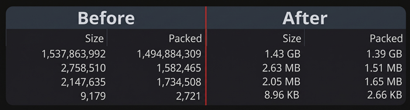
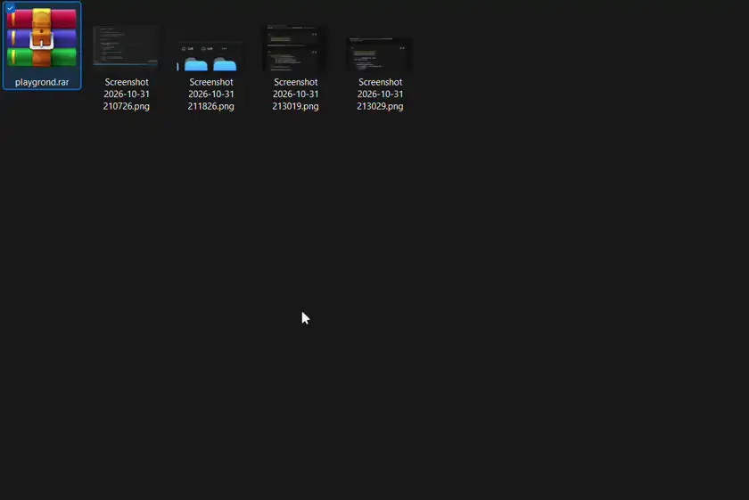

# WinRAR Tweaks

All-in-one quality-of-life enhancements for **WinRAR** that modernize navigation and file size readability without altering archive behavior.

---

## ✨ Features

* ⌨️ **Smart Close on `Esc`:** Quickly close WinRAR with the `Escape` key—just like modern utilities and viewers. Intelligently respects active context menus, menu bars, dropdowns, inline file renaming, and child dialogs (closing open popups first before closing the main window).
* 📊 **Human-Readable File Sizes:** Automatically converts hard-to-read raw byte counts (e.g., `121815`) in the **Size** and **Packed** columns into clean, readable units (`B`, `KB`, `MB`, `GB`, `TB`).
* ⚙️ **Modular Settings:** Toggle either tweak independently at any time in the mod's Settings tab.

## 🖼️ Previews

### Human-Readable File Sizes

### Smart Close on Esc

---

## 🛠️ How It Works

* **Modal & Input Guarding:** Queries live Win32 thread GUI state (`GetGUIThreadInfo`) so `Esc` never interrupts active menu loops, drag/capture operations, dropdowns, or inline `Edit` rename boxes before sending `WM_CLOSE`.
* **In-Place ListView Formatting:** Subclasses WinRAR's `SysListView32` file list (both newly created and already-open windows) and formats raw byte counts on the fly as items are populated or refreshed.

---

## ⚠️ Compatibility & Notes

* **Refreshing After Changing Settings or Disabling:** If you toggle the *Human-Readable File Sizes* setting on or off, or disable/remove the mod while WinRAR is open, please press **`F5`** or navigate to another folder and back to refresh the file list with the updated size format.
* **Supported Column Languages:** Out-of-the-box header detection supports English (`Size`, `Packed`) as well as common localized headers (`Размер`, `Сжатый`, `Größe`, `Gepackt`, `Taille`, `Compressé`, `Tamaño`, `Comprimido`).
* **Sorting Behavior:** Because WinRAR sorts internal archive records prior to display formatting, sorting by Size or Packed continues to sort accurately by exact byte count.

---

### 🧩 More from this author
* **[Drag to Scroll](https://windhawk.net/mods/drag-to-scroll)** – Hold `Ctrl + Right-Click` and drag to scroll smoothly across desktop applications.
* **[Explorer Custom Shortcuts](https://windhawk.net/mods/explorer-custom-shortcuts)** – Customizable keyboard shortcuts for File Explorer: open terminal, copy paths, create files/folders, toggle hidden items, and launch apps with hotkeys.

### Author & Attribution
* **Created and maintained by ArvindSaini978 ([GitHub](https://github.com/ArvindSaini978)).**
